# Disease Outbreak Early Warning System

## Overview

The **Disease Outbreak Early Warning System** is a statistical surveillance and forecasting project designed to examine historical dengue incidence, identify periods of elevated disease activity, and generate threshold-based early warning signals.

The project integrates epidemiological surveillance records with environmental measurements and applies exploratory data analysis, time series analysis, statistical forecasting, and threshold-based risk classification. The analytical workflow demonstrates how historical disease surveillance data can be transformed into structured information to support outbreak monitoring and public health preparedness.

Two forecasting approaches, Exponential Smoothing and ARIMA are evaluated using a chronological training and testing framework. A separate statistical thresholding procedure is then applied to historical dengue incidence to identify potential outbreak periods and classify disease activity into operational risk categories.

The project provides an applied demonstration of statistical methods for disease surveillance, time series forecasting, and early warning analysis.

---

# Project Objectives

The primary objectives of this project are to:

- Integrate epidemiological surveillance records with environmental measurements.
- Examine the distribution and temporal characteristics of dengue incidence.
- Explore geographic differences and seasonal patterns in reported cases.
- Assess missing observations and apply an appropriate imputation procedure.
- Evaluate the stationarity of the aggregated dengue incidence series.
- Develop and compare statistical forecasting models.
- Identify periods of elevated disease activity using a statistical threshold.
- Classify historical disease activity into operational risk categories.
- Generate high-risk alert records to support surveillance and monitoring.

---

# Research Question

Can statistical time series forecasting and threshold-based outbreak detection methods be applied to historical dengue surveillance data to identify periods of elevated disease activity and support early warning analysis?

---

# Dataset

The project uses two dengue surveillance datasets containing weekly disease incidence records and associated environmental measurements.

### Dataset Files

| Dataset | Description | Records |
|---|---|---:|
| `dengue_features_train.csv` | Environmental and epidemiological features | 1,456 |
| `dengue_labels_train.csv` | Weekly dengue case counts | 1,456 |

The two datasets are merged using three common identifiers:

- `city`
- `year`
- `weekofyear`

The resulting integrated dataset contains **1,456 observations and 25 columns**.

### Variables

The integrated dataset contains disease incidence information and environmental measurements, including:

- Temperature measurements
- Precipitation measurements
- Relative and specific humidity
- Vegetation indices (NDVI)
- Epidemiological week and year
- Weekly dengue case counts (`total_cases`)

### Dataset Summary

| Metric | Value |
|---|---:|
| Feature dataset records | 1,456 |
| Label dataset records | 1,456 |
| Integrated dataset records | 1,456 |
| Integrated dataset columns | 25 |
| Aggregated weekly observations | 1,049 |
| Observation period | 1990–2010 |
| Frequency | Weekly |
| Forecasting target | `total_cases` |
| Missing value treatment | Median imputation |

**Important analytical distinction:** Although environmental variables are included in the integrated dataset and examined during exploratory analysis and missing-value assessment, the forecasting models developed in this project use the aggregated historical dengue case series as their input. Environmental variables are not included as forecasting predictors.

---

# Technology Stack

| Technology | Application |
|---|---|
| Python | Data analysis and statistical modeling |
| Pandas | Data manipulation, integration, and aggregation |
| NumPy | Numerical operations |
| Matplotlib | Statistical visualization |
| Seaborn | Exploratory and comparative visualizations |
| Statsmodels | Stationarity testing and time series forecasting |
| Jupyter Notebook | Analytical workflow and documentation |

---

# Methodology

The project follows a structured statistical workflow comprising six analytical stages.

## 1. Data Collection and Integration

The environmental feature dataset and dengue case-count dataset are loaded and inspected independently.

The datasets are merged using `city`, `year`, and `weekofyear` as common identifiers. This produces an integrated dataset containing 1,456 observations and 25 columns.

The integration stage establishes the analytical dataset used throughout the subsequent exploratory and modeling procedures.

## 2. Exploratory Data Analysis

Exploratory analysis is conducted to understand the distribution and temporal characteristics of dengue incidence.

The analysis includes:

- Descriptive statistical summaries.
- Distribution of weekly dengue cases.
- Comparison of dengue incidence across cities.
- Annual dengue case trends.
- Average dengue incidence by epidemiological week.

These analyses provide an initial understanding of disease variability, differences between surveillance locations, and recurring temporal patterns.

## 3. Missing Data Assessment and Imputation

Missing observations are examined across the integrated dataset.

The assessment identifies incomplete values in several environmental variables, particularly vegetation indices and selected temperature, humidity, and precipitation measurements.

Median-based imputation is applied to numeric columns to address missing observations.

The resulting dataset contains no remaining missing values following the imputation procedure.

## 4. Time Series Construction and Stationarity Testing

The `week_start_date` variable is converted into a datetime format, and dengue case counts are aggregated across cities by date.

This produces a univariate weekly time series containing **1,049 observations** between 1990 and 2010.

Rolling means and rolling standard deviations are calculated using a 12-week window to examine changes in the temporal behavior of the series.

The Augmented Dickey-Fuller (ADF) test is then applied to evaluate stationarity.

### ADF Test Results

| Metric | Result |
|---|---:|
| ADF Statistic | -5.9398 |
| P-value | 2.2757 × 10⁻⁷ |
| Significance Level | 0.05 |
| Decision | Reject the unit-root null hypothesis |

The p-value is substantially below the conventional 0.05 significance level. Therefore, the null hypothesis of a unit root is rejected, providing statistical evidence that the aggregated dengue incidence series is stationary under the ADF test.

## 5. Time Series Forecasting

Two statistical forecasting approaches are developed and evaluated.

### Exponential Smoothing

An Exponential Smoothing model with an additive trend component and no seasonal component is fitted to the training observations.

The model generates forecasts over the testing period, allowing its predictive performance to be evaluated against observed dengue incidence.

### ARIMA(1,0,1)

An ARIMA model with the specification ARIMA(1,0,1) is developed using the same training series.

The model generates forecasts for the testing period and a separate 12-week forecast beyond the observed training period.

### Training and Testing Strategy

The time series is divided chronologically:

| Dataset | Observations | Proportion |
|---|---:|---:|
| Training set | 839 | 80% |
| Testing set | 210 | 20% |
| Total | 1,049 | 100% |

The chronological split preserves the temporal ordering of observations and reserves the final 20% of the series for model evaluation.

## 6. Model Evaluation

Forecasting performance is assessed using three evaluation metrics:

- **Mean Absolute Error (MAE):** Measures the average absolute difference between observed and predicted values.
- **Root Mean Squared Error (RMSE):** Measures the square root of the average squared prediction errors.
- **Mean Absolute Percentage Error (MAPE):** Measures prediction error relative to observed values.

### Forecasting Performance

| Model | MAE | RMSE | MAPE |
|---|---:|---:|---:|
| Exponential Smoothing | 16.12 | 28.57 | NaN |
| ARIMA(1,0,1) | 24.32 | 30.16 | NaN |

Exponential Smoothing achieves lower MAE and RMSE values than ARIMA(1,0,1) on the testing observations.

Consequently, Exponential Smoothing is selected as the better-performing model based on the reported MAE and RMSE results.

**MAPE limitation:** MAPE is reported as NaN for both models in the notebook. This is associated with zero-valued actual observations in the testing data, which make the percentage-error calculation undefined for those observations. Therefore, MAPE is not used to determine the preferred model.

## 7. Future Dengue Forecasting

A separate 12-week forecast is generated using the fitted ARIMA(1,0,1) model.

The forecast produces the following predicted weekly dengue incidence values:

| Forecast Week | Predicted Cases |
|---:|---:|
| 1 | 9.16 |
| 2 | 10.58 |
| 3 | 11.92 |
| 4 | 13.20 |
| 5 | 14.41 |
| 6 | 15.57 |
| 7 | 16.67 |
| 8 | 17.71 |
| 9 | 18.70 |
| 10 | 19.64 |
| 11 | 20.54 |
| 12 | 21.39 |

The ARIMA forecast indicates a gradual increase in predicted weekly dengue incidence over the 12-week forecast horizon.

This future forecast is a separate ARIMA output; it does not change the model evaluation result in which Exponential Smoothing achieves lower testing errors.

## 8. Outbreak Detection and Risk Classification

A statistical threshold is established using the historical mean and standard deviation of the aggregated weekly dengue incidence series.

The outbreak threshold is calculated as:

**Outbreak Threshold = Mean Cases + Standard Deviation**

| Metric | Value |
|---|---:|
| Mean weekly cases | 34.25 |
| Standard deviation | 48.87 |
| Outbreak threshold | 83.12 |

Historical weeks with case counts exceeding 83.12 are flagged as potential outbreak periods.

### Risk Classification

Disease activity is classified into three operational categories:

| Risk Category | Classification Rule |
|---|---|
| Low Risk | Cases below the historical mean |
| Moderate Risk | Cases at or above the mean but below the outbreak threshold |
| High Risk | Cases at or above the outbreak threshold |

### Risk Classification Results

| Risk Category | Number of Weeks |
|---|---:|
| Low Risk | 748 |
| Moderate Risk | 229 |
| High Risk | 72 |
| **Total** | **1,049** |

A total of **72 weeks**, representing approximately **6.86%** of the aggregated observations, are classified as High Risk.

These observations are extracted into a separate high-risk alert dataset for further examination.

**Interpretation:** The threshold-based procedure identifies historical periods of elevated dengue incidence. These are statistical surveillance flags rather than epidemiologically validated outbreak declarations.

---

# Visualizations

The project includes visualizations covering exploratory analysis, missing-value assessment, forecasting, model comparison, and outbreak detection.

## Distribution of Weekly Dengue Cases

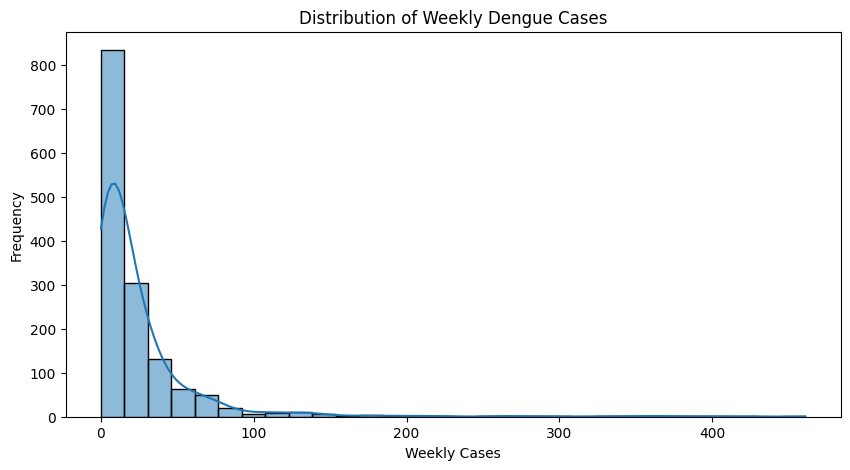

The distribution illustrates the variability in weekly dengue incidence, including the concentration of lower case counts and the presence of weeks with substantially higher reported cases.

---

## Dengue Cases by City

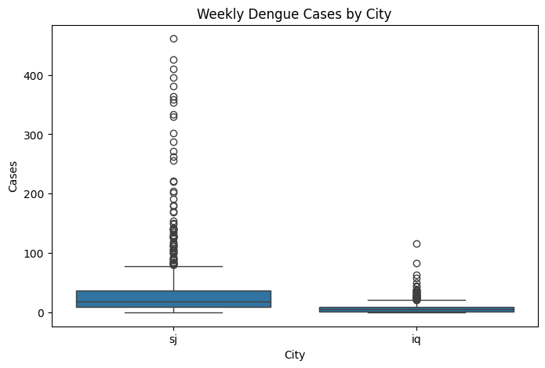

The comparison examines differences in weekly dengue incidence across the two surveillance locations.

---

## Annual Dengue Trend

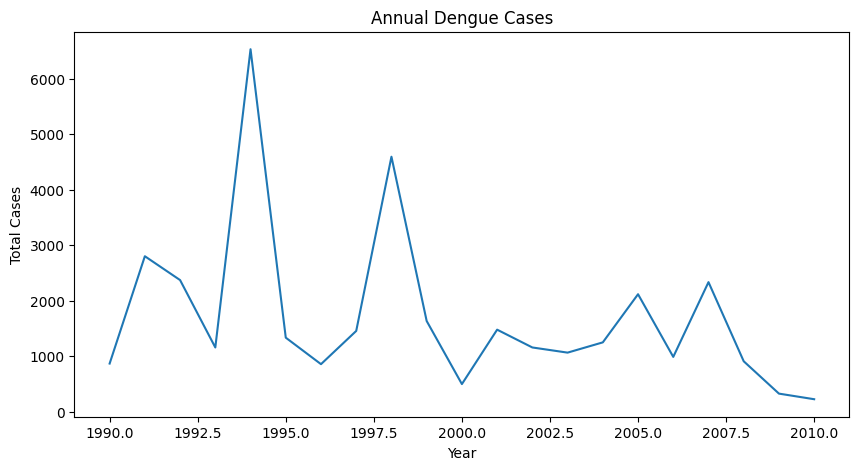

Annual aggregation provides a view of changes in reported dengue incidence across the observation period.

---

## Seasonal Disease Pattern

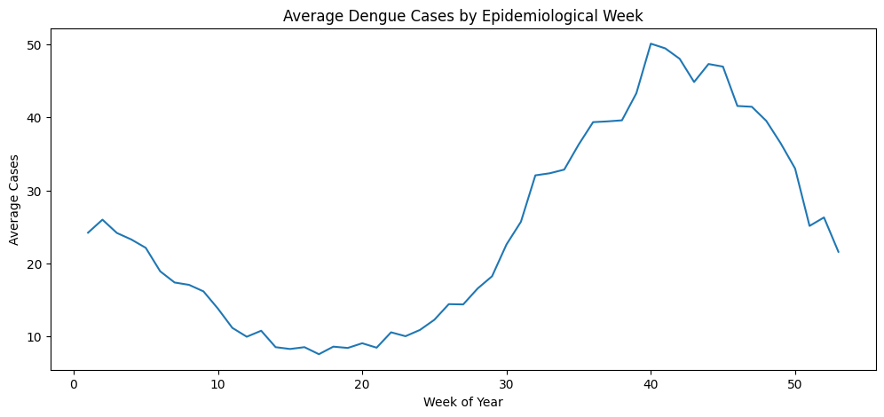

Average weekly dengue incidence demonstrates variation across epidemiological weeks, allowing recurring temporal patterns to be explored.

---

## Missing Value Assessment

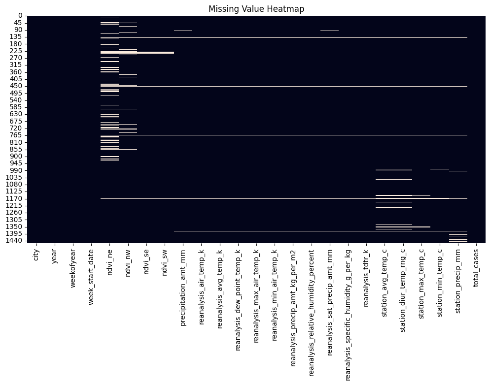

The heatmap illustrates missing observations across the environmental and epidemiological variables before imputation.

---

## Rolling Statistics

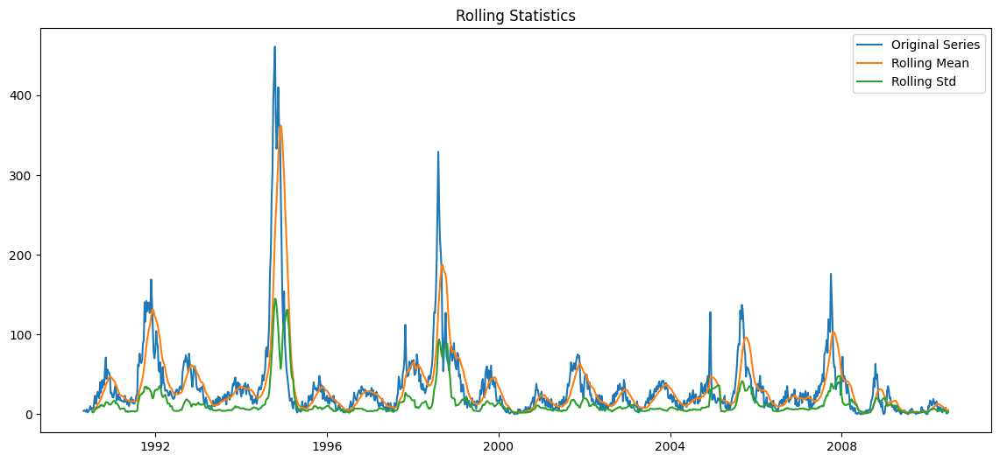

Rolling mean and rolling standard deviation are used to visually examine temporal variation in the aggregated dengue incidence series.

---

## Exponential Smoothing Forecast

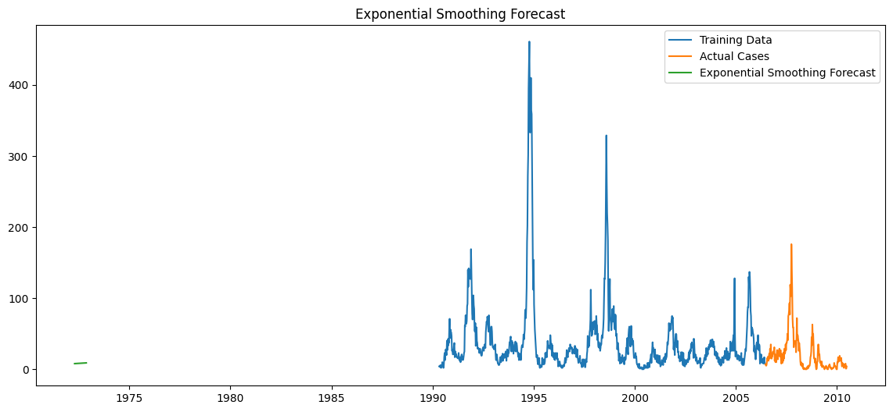

The visualization compares the Exponential Smoothing forecast with observed dengue incidence during the testing period.

---

## ARIMA Forecast

The ARIMA(1,0,1) model generates forecasts using the historical dengue incidence series.

---

## Forecast Comparison

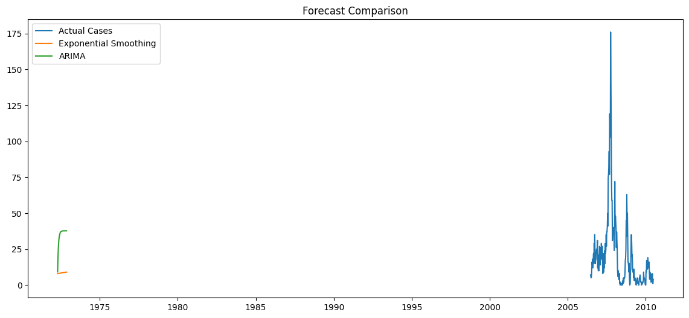

Forecasts from Exponential Smoothing and ARIMA are compared against observed dengue incidence during the testing period.

---

## Future Dengue Forecast

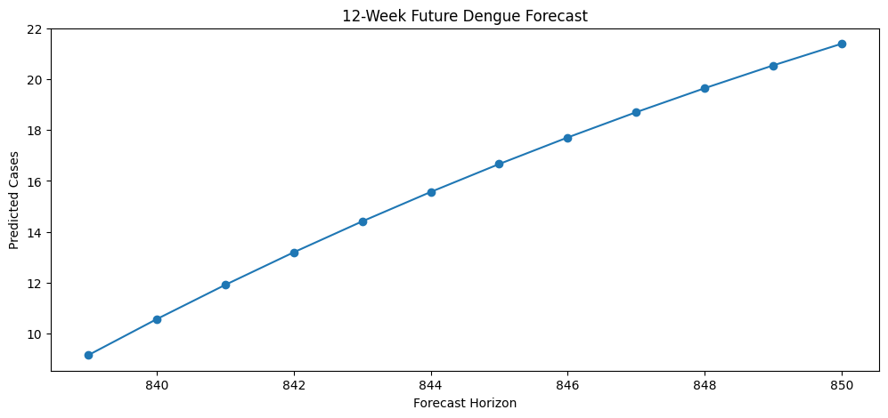

The 12-week ARIMA forecast illustrates the projected progression of dengue incidence beyond the observed training period.

---

## Historical Outbreak Detection

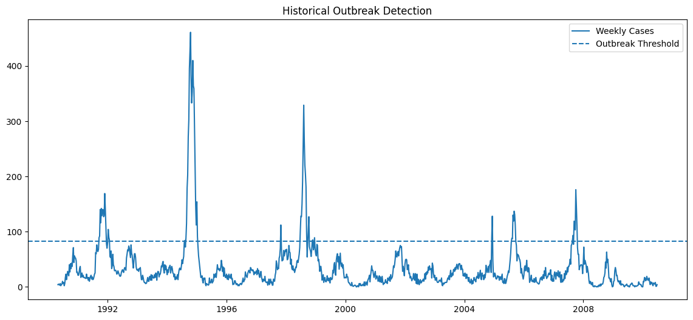

The visualization identifies historical weeks exceeding the calculated outbreak threshold.

---

## Risk Category Distribution

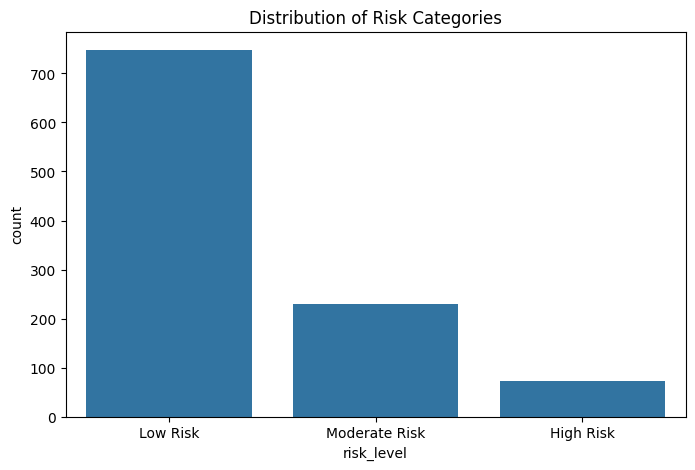

The distribution summarizes the number of observations assigned to Low Risk, Moderate Risk, and High Risk categories.

---

## Model Comparison

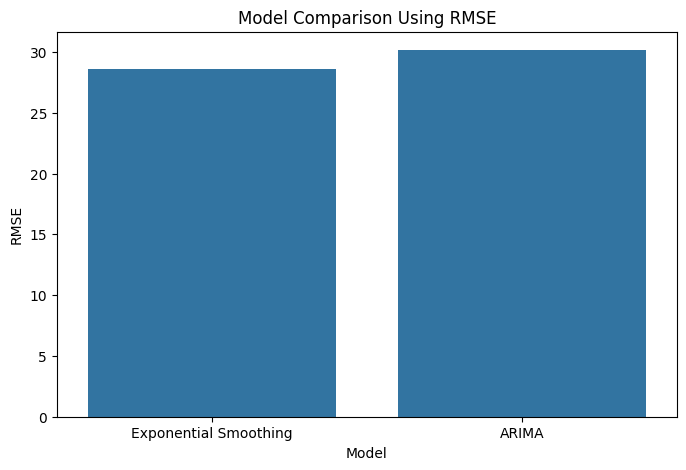

The comparison evaluates the forecasting models using RMSE, highlighting the lower error achieved by Exponential Smoothing.

---

## Forecast Error Distribution

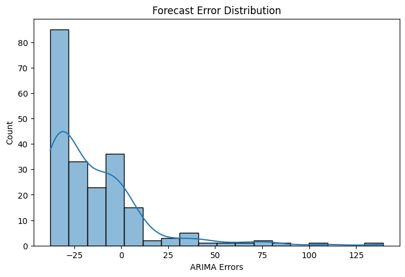

The distribution examines ARIMA forecast errors during the testing period.

---

# Key Findings

The analysis produced several findings:

1. **Dataset integration:** The two source datasets were successfully merged into an integrated dataset containing 1,456 observations and 25 columns.

2. **Missing data:** Several environmental variables contained missing observations. Median-based imputation addressed missing numeric values.

3. **Stationarity:** The ADF test produced a statistic of approximately -5.94 and a p-value of 2.28 × 10⁻⁷, providing evidence against the unit-root null hypothesis.

4. **Forecasting performance:** Exponential Smoothing achieved an MAE of 16.12 and RMSE of 28.57, outperforming ARIMA(1,0,1), which recorded an MAE of 24.32 and RMSE of 30.16.

5. **Future forecast:** The separate 12-week ARIMA forecast projected an increase in weekly dengue incidence from approximately 9.16 to 21.39 cases.

6. **Outbreak detection:** The historical mean-plus-one-standard-deviation threshold was 83.12 cases.

7. **High-risk periods:** The threshold-based classification identified 72 high-risk weeks, representing approximately 6.86% of the 1,049 weekly observations.

---

# Project Workflow

The analytical workflow is organized into six notebooks:

| Notebook | Description |
|---|---|
| Notebook 01 | Data Collection and Integration |
| Notebook 02 | Exploratory Time Series Analysis |
| Notebook 03 | Missing Data Assessment and Stationarity Testing |
| Notebook 04 | Time Series Forecasting Models |
| Notebook 05 | Outbreak Detection and Early Warning Alerts |
| Notebook 06 | Model Evaluation and Performance Analysis |

### Generated Analytical Outputs

The notebook workflow also generates structured CSV outputs:

| File | Description |
|---|---|
| `risk_summary.csv` | Summary of observations across the three risk categories |
| `high_risk_alerts.csv` | Historical observations classified as High Risk |
| `model_performance_summary.csv` | Comparative forecasting performance metrics |

---

# Limitations and Future Improvements

Although the project demonstrates an integrated statistical workflow for historical dengue surveillance, several limitations should be considered.

### Current Limitations

- **Univariate forecasting:** Forecasting is based on aggregated historical dengue case counts. Environmental variables are not incorporated as explanatory predictors in the forecasting models.
- **Limited model selection:** The analysis evaluates two forecasting approaches: Exponential Smoothing and ARIMA(1,0,1).
- **MAPE calculation:** MAPE is undefined in the reported evaluation because the testing observations include zero-valued actual cases.
- **Threshold-based outbreak detection:** The mean-plus-one-standard-deviation threshold is a statistical rule and has not been epidemiologically validated.
- **Historical analysis:** The project analyzes historical surveillance observations rather than a live data stream.
- **Forecast uncertainty:** The reported forecasts are point predictions; the notebook does not establish prediction intervals or probabilistic risk estimates.

### Potential Future Improvements

Further development could explore:

- Multivariate time series forecasting incorporating environmental predictors.
- Additional statistical and machine learning forecasting models.
- Seasonal ARIMA and other models that explicitly account for seasonal structures.
- Alternative outbreak detection methods and threshold validation.
- Prediction intervals and uncertainty quantification.
- Geographic analysis of outbreak patterns.
- Automated integration of updated surveillance data.
- Real-time monitoring and interactive visualization dashboards.
- Evaluation of alert performance against independently established epidemiological outbreak criteria.

These improvements could strengthen the analytical framework and support more comprehensive disease surveillance applications.

---

# References

The project applies established statistical methods and Python-based analytical tools.

- Hyndman, R. J., & Athanasopoulos, G. (2021). *Forecasting: Principles and Practice* (3rd ed.). OTexts. https://otexts.com/fpp3/
- Dickey, D. A., & Fuller, W. A. (1979). Distribution of the estimators for autoregressive time series with a unit root. *Journal of the American Statistical Association, 74*(366), 427–431.
- McKinney, W. (2010). Data structures for statistical computing in Python. *Proceedings of the 9th Python in Science Conference*, 56–61.
- Seabold, S., & Perktold, J. (2010). Statsmodels: Econometric and statistical modeling with Python. *Proceedings of the 9th Python in Science Conference*.

---

# Conclusion

The Disease Outbreak Early Warning System demonstrates an applied statistical workflow for examining historical dengue incidence, evaluating forecasting approaches, and identifying periods of elevated disease activity.

Through exploratory analysis, missing-data treatment, stationarity testing, forecasting, and threshold-based risk classification, the project illustrates how statistical methods can support the interpretation of epidemiological surveillance data.

The comparison of Exponential Smoothing and ARIMA highlights the importance of empirical model evaluation, while the outbreak detection procedure demonstrates how historical incidence thresholds can be used to identify periods requiring further attention.

Overall, the project provides a foundation for further investigation into statistical forecasting, disease surveillance, and data-driven early warning methodologies.
